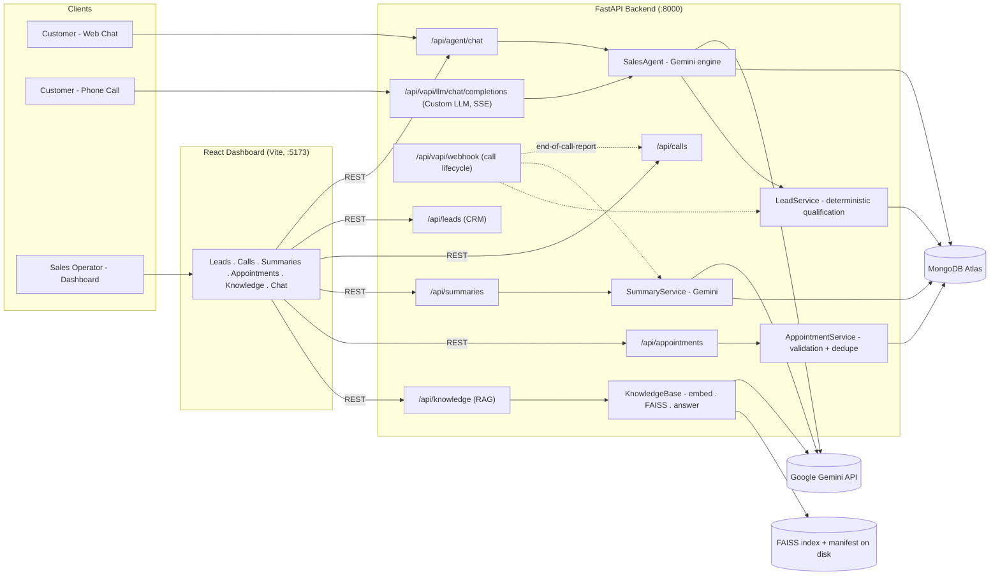

# SalesPilot AI — Autonomous AI Sales Voice Agent

SalesPilot AI is an end-to-end AI sales agent. It talks to customers over **chat**
and **live voice calls**, collects and qualifies leads deterministically, stores
everything in MongoDB, summarises every call, books appointments, and answers
product questions from your own documents with a retrieval-augmented (RAG)
knowledge base. A React dashboard gives a single pane of glass over all of it.

Everything in this repository is implemented and works locally end-to-end. The
only piece that needs your own credentials is placing **real phone calls through
Vapi** (see [Limitations](#limitations--manual-configuration)).

---

## Table of contents

- [Tech stack](#tech-stack)
- [Architecture](#architecture)
- [End-to-end workflow](#end-to-end-workflow)
- [Project structure](#project-structure)
- [Setup](#setup)
- [Environment variables](#environment-variables)
- [API reference](#api-reference)
- [Dashboard guide](#dashboard-guide)
- [Demo script (interview walkthrough)](#demo-script-interview-walkthrough)
- [Security](#security)
- [Scalability for 100K users](#scalability-for-100k-users)
- [Infrastructure cost estimate](#infrastructure-cost-estimate)
- [Testing](#testing)
- [Limitations & manual configuration](#limitations--manual-configuration)

---

## Tech stack

| Layer      | Technology                                            |
| ---------- | ----------------------------------------------------- |
| Frontend   | React 18 + Vite                                       |
| Backend    | Python + FastAPI (Uvicorn)                            |
| AI / LLM   | Google Gemini (`google-genai`)                        |
| Database   | MongoDB Atlas (pymongo)                               |
| Voice      | Vapi (Custom LLM + server webhooks)                   |
| RAG        | FAISS (`IndexFlatIP`) + `gemini-embedding-001` + pypdf |

---

## Architecture



**Key design decisions**

- **One engine, two channels.** Web chat and voice calls both run through the
  same `SalesAgent`, so lead extraction, persistence and qualification behave
  identically. A Vapi call's `call.id` becomes the conversation id (unless Vapi
  supplies `metadata.conversation_id`), keeping a single conversation across
  channels.
- **Deterministic over AI where it matters.** HOT/WARM/COLD classification, lead
  completeness, duplicate detection and appointment conflicts are computed in
  plain Python — never judged by the model.
- **Custom LLM, not a native Vapi model.** Vapi's "Custom LLM" (OpenAI-compatible)
  integration keeps our backend in the loop for every spoken turn, so persistence
  and lead extraction remain server-side.
- **Grounded RAG or nothing.** Answers use only retrieved chunks; anything below
  the similarity threshold returns an "information unavailable" fallback instead
  of a hallucination.

---

## End-to-end workflow

1. **Inbound contact** — a customer chats on the dashboard or calls the Vapi
   number. Voice turns are streamed to Vapi's Custom LLM endpoint as SSE.
2. **Conversation turn** — `SalesAgent` calls Gemini with a structured-output
   schema and asks for a natural reply plus the lead fields collected so far.
   The turn is persisted to the `conversations` collection.
3. **CRM sync** — `LeadService` merges the new fields (existing values are never
   overwritten by omissions), normalises the phone number, classifies the lead
   HOT/WARM/COLD, and upserts it into `leads`.
4. **Call end** — Vapi posts an `end-of-call-report`. The call record is stored in
   `calls`, the lead's `call_history` is updated, and a Gemini summary is
   generated into `call_summaries` (summary, requirements, objections, sentiment,
   follow-up actions). Duplicate webhook deliveries are ignored.
5. **Booking** — an appointment is validated (future time, linked customer, no
   double-booking for the same customer + minute) and persisted to `appointments`.
   The customer is only told it is booked once it is saved.
6. **Knowledge** — operators upload PDFs; text is chunked, embedded and stored in
   FAISS. Customer questions retrieve the closest chunks and are answered from
   that context only.

---

## Project structure

```
SalesPilot AI/
├── backend/
│   ├── app/
│   │   ├── main.py                    # FastAPI app, CORS, routers, startup diagnostics
│   │   ├── api/routes/
│   │   │   ├── health.py              # GET  /api/health
│   │   │   ├── agent.py               # POST /api/agent/chat
│   │   │   ├── vapi.py                # Vapi Custom LLM + webhook + outbound
│   │   │   ├── leads.py               # CRM read/update
│   │   │   ├── calls.py               # Call history (read-only)
│   │   │   ├── summaries.py           # Call summaries (generate/list/get)
│   │   │   ├── appointments.py        # Booking (create/list/get/patch)
│   │   │   └── knowledge.py           # RAG upload/list/query
│   │   ├── core/config.py             # Settings loaded from backend/.env
│   │   ├── schemas/                   # Pydantic request/response models
│   │   └── services/
│   │       ├── sales_agent.py         # Gemini sales engine
│   │       ├── conversation_store.py  # conversations + calls + webhook_events
│   │       ├── lead_store.py          # leads collection
│   │       ├── lead_service.py        # deterministic qualification + sync
│   │       ├── summary_store.py       # call_summaries collection
│   │       ├── summary_service.py     # Gemini summarisation
│   │       ├── appointment_store.py   # appointments collection (+ unique dedupe index)
│   │       ├── appointment_service.py # booking validation + dedupe logic
│   │       ├── vapi_service.py        # Vapi adapter (turns, webhooks, outbound)
│   │       └── rag/                   # pdf_loader, chunker, embeddings, vector_store, knowledge_base, answerer
│   ├── data/knowledge_base/           # FAISS index + manifest (git-ignored)
│   ├── requirements.txt
│   └── .env.example
├── frontend/
│   ├── src/
│   │   ├── main.jsx
│   │   ├── App.jsx                    # Dashboard shell + tab navigation
│   │   ├── api/client.js              # API base URL + fetch wrapper + error mapping
│   │   ├── hooks/useAsync.js          # loading / error / reload hook
│   │   ├── components/                # ui.jsx + one panel per feature
│   │   └── index.css                  # Responsive dashboard styling
│   ├── index.html
│   ├── package.json
│   └── .env.example
├── .gitignore
└── README.md
```

---

## Setup

### Prerequisites

- Node.js 18+ and npm
- Python 3.10+
- A MongoDB Atlas connection string
- A Google Gemini API key

### Backend

```powershell
cd backend
python -m venv .venv
.\.venv\Scripts\Activate.ps1
pip install -r requirements.txt
Copy-Item .env.example .env      # then fill in real values
uvicorn app.main:app --reload --port 8000
```

- Health: http://localhost:8000/api/health
- Swagger UI: http://localhost:8000/docs

On startup the server logs which integrations are configured — only booleans and
non-secret values are ever printed.

### Frontend

```powershell
cd frontend
npm install
Copy-Item .env.example .env
npm run dev
```

- Dashboard: http://localhost:5173

Production build:

```powershell
npm run build      # outputs to frontend/dist
npm run preview
```

---

## Environment variables

Copy each `.env.example` to `.env`. `.env` files are git-ignored and must never
be committed.

### `backend/.env`

| Variable                  | Description                                                                 |
| ------------------------- | --------------------------------------------------------------------------- |
| `APP_NAME`, `APP_VERSION` | Application name / version                                                  |
| `HOST`, `PORT`            | Server bind address (default `0.0.0.0:8000`)                                |
| `CORS_ORIGINS`            | Comma-separated allowed frontend origins (default `http://localhost:5173`)  |
| `MONGODB_URI`             | MongoDB Atlas connection string (**secret**)                                |
| `MONGODB_DB_NAME`         | Database name (default `salespilot`)                                        |
| `GEMINI_API_KEY`          | Google Gemini API key (**secret**)                                          |
| `GEMINI_MODEL`            | Generative model (default `gemini-2.5-flash`)                               |
| `GEMINI_TEMPERATURE`      | Sampling temperature (default `0.4`)                                        |
| `GEMINI_EMBEDDING_MODEL`  | Embedding model (default `gemini-embedding-001`)                            |
| `RAG_EMBEDDING_DIMENSION` | Vector size requested from the embedder (default `768`)                     |
| `RAG_CHUNK_SIZE`, `RAG_CHUNK_OVERLAP` | Chunking target characters / overlap (1000 / 150)                 |
| `RAG_TOP_K`, `RAG_MIN_SCORE` | Chunks retrieved / minimum cosine similarity to trust (4 / `0.50`)       |
| `RAG_DATA_DIR`            | FAISS index directory (empty = `backend/data/knowledge_base`)               |
| `VAPI_API_KEY`            | Vapi API key for outbound calls (**secret**)                                |
| `VAPI_PHONE_NUMBER_ID`    | Vapi phone number id                                                        |
| `VAPI_ASSISTANT_ID`       | Vapi assistant id (Custom LLM assistant)                                    |
| `VAPI_LLM_MODEL_NAME`     | Label returned to Vapi for the Custom LLM (default `salespilot-gemini`)     |
| `VAPI_WEBHOOK_SECRET`     | Shared secret sent as `x-vapi-secret`, protecting `/api/vapi/*` (**secret**) |
| `PUBLIC_BASE_URL`         | Public HTTPS URL where Vapi can reach this backend (use a tunnel in dev)    |

`backend/.env` is resolved relative to the source tree, so uvicorn finds it
regardless of the working directory it was launched from.

### `frontend/.env`

| Variable            | Description                          |
| ------------------- | ------------------------------------ |
| `VITE_API_BASE_URL` | Base URL of the backend (default `http://localhost:8000`) |

> Secrets live only in `backend/.env`. The frontend never receives a key.

---

## API reference

All endpoints are under `/api`. Error handling is consistent across the API:
`400` bad input/file, `404` unknown id, `409` conflict (duplicate), `413` upload
too large, `422` validation, `429` Gemini quota (with `Retry-After`), `502`
upstream (Gemini/Vapi) failure, `503` missing configuration or database
unavailable. Sensitive values never appear in error messages.

### Health

| Method | Path          | Purpose                    |
| ------ | ------------- | -------------------------- |
| `GET`  | `/api/health` | Service status + timestamp |

### Sales agent (chat)

**`POST /api/agent/chat`** — run one conversation turn.

```json
// request
{ "message": "Hi, I need a CRM for my team.", "conversation_id": null }
```

```json
// response
{
  "conversation_id": "16b14bbf-...",
  "response": "Great! How many people are on your team?",
  "lead": { "name": null, "phone": null, "budget": null, "product_interest": null, "purchase_timeline": null },
  "missing_fields": ["name", "phone", "budget", "product_interest", "purchase_timeline"],
  "is_lead_complete": false,
  "turn": 1
}
```

Omit `conversation_id` to start a new conversation; an unknown id returns `404`
(never a silent new conversation). Conversations and the lead persist in
MongoDB, so a `conversation_id` resumes across restarts.

### Vapi voice integration

| Method | Path                                | Purpose                                                   |
| ------ | ----------------------------------- | --------------------------------------------------------- |
| `POST` | `/api/vapi/llm/chat/completions`    | OpenAI-compatible turn endpoint used by Vapi Custom LLM (SSE when `stream` is true) |
| `POST` | `/api/vapi/webhook`                 | Call lifecycle events (status, transcript, end-of-call report, assistant-request) |
| `POST` | `/api/vapi/call`                    | Start an outbound call via the Vapi REST API              |

All three require `VAPI_WEBHOOK_SECRET`, sent as the `x-vapi-secret` header or an
`Authorization: Bearer` token; a missing/invalid secret returns `401`. With no
secret configured the endpoints are unprotected and the server logs a warning at
startup. Webhook events are recorded in `webhook_events`, so a retried delivery
returns `{"received": true, "duplicate": true}` and is not applied twice.
`POST /api/vapi/call` returns `503` when Vapi credentials are missing — it never
fakes a successful call.

### Leads (CRM)

| Method  | Path                    | Purpose                                                                 |
| ------- | ----------------------- | ----------------------------------------------------------------------- |
| `GET`   | `/api/leads`            | List leads. Filters: `interest_level`, `status`, `phone`, `q`; paging: `limit` (1–200), `skip` |
| `GET`   | `/api/leads/{lead_id}`  | View one lead (`404` when unknown)                                      |
| `PATCH` | `/api/leads/{lead_id}`  | Update `name`, `budget`, `requirements`, `interest_level`, `status`, `notes` |

Qualification is deterministic: contactability + number of details + timeline
urgency decide HOT/WARM/COLD, and leads are deduplicated on a canonical
digits-only phone number.

### Calls

| Method | Path                 | Purpose                                                          |
| ------ | -------------------- | ---------------------------------------------------------------- |
| `GET`  | `/api/calls`         | List stored calls. Filters: `conversation_id`, `status`; paging    |
| `GET`  | `/api/calls/{call_id}` | View one call incl. transcript, summary, recording url           |

### Call summaries (Step 6)

| Method | Path                      | Purpose                                                                 |
| ------ | ------------------------- | ----------------------------------------------------------------------- |
| `POST` | `/api/summaries/generate` | Summarise a `call_id`, a `conversation_id` **or** a raw `transcript` (exactly one) |
| `GET`  | `/api/summaries`          | List summaries. Filters: `call_id`, `conversation_id`, `lead_id`, `sentiment` |
| `GET`  | `/api/summaries/{id}`     | View one summary                                                        |

```json
// POST /api/summaries/generate
{ "transcript": "Customer: I need a CRM...\nAgent: What is your budget?" }
```

```json
// 201 response (abridged)
{
  "id": "ce0068a8-...",
  "call_id": null,
  "summary": "The customer is looking for a CRM for a team of 12...",
  "requirements": ["CRM for 12 people", "Budget around 50,000 rupees"],
  "objections": ["Onboarding might take too long"],
  "sentiment": "NEUTRAL",
  "follow_up_actions": ["Send a proposal", "Confirm the start date"],
  "model": "gemini-2.5-flash"
}
```

A summary is also generated automatically when Vapi sends an `end-of-call-report`,
and is linked to the call, conversation and lead.

### Appointments (Step 6)

| Method  | Path                        | Purpose                                                            |
| ------- | --------------------------- | ------------------------------------------------------------------ |
| `POST`  | `/api/appointments`         | Book (validated + persisted before confirming)                     |
| `GET`   | `/api/appointments`         | List. Filters: `lead_id`, `conversation_id`, `status`, `phone`, `upcoming=true` |
| `GET`   | `/api/appointments/{id}`    | View one appointment                                                |
| `PATCH` | `/api/appointments/{id}`    | Update / `COMPLETED` / `CANCELLED` (`scheduled_at`, `title`, `duration_minutes`, `status`, `notes`) |

```json
// POST /api/appointments
{ "scheduled_at": "2026-12-15T10:00:00Z", "title": "Demo call",
  "duration_minutes": 30, "phone": "9998887776", "customer_name": "Test User" }
```

Validation: the time must be in the future (`422`), a `lead_id` or `phone` is
required (`422`), and a second booking for the same customer + start minute is
rejected with `409`. Cancelling frees the slot for rebooking. The appointment is
only reported as booked after it is saved to MongoDB.

### RAG knowledge base

| Method | Path                           | Purpose                                                     |
| ------ | ------------------------------ | ----------------------------------------------------------- |
| `POST` | `/api/knowledge/documents`     | Upload + index a PDF (`multipart/form-data`, field `file`, ≤ 15 MB) |
| `GET`  | `/api/knowledge/documents`     | List indexed documents                                      |
| `POST` | `/api/knowledge/query`         | Answer a question using only the knowledge base             |

```json
// POST /api/knowledge/query
{ "question": "What is the refund policy?", "top_k": 4 }

// response
{ "question": "...", "answer": "...", "found": true,
  "sources": [{ "filename": "handbook.pdf", "page": 1, "score": 0.69, "text": "..." }],
  "model": "gemini-2.5-flash" }
```

The FAISS index and document manifest are persisted under
`backend/data/knowledge_base`, so the knowledge base survives a restart.

---

## Dashboard guide

Start the backend, then `npm run dev` in `frontend/`. The dashboard has seven
tabs and a live backend-health indicator in the sidebar.

| Tab               | What it shows                                                                              |
| ----------------- | ------------------------------------------------------------------------------------------ |
| **Overview**      | KPI cards (total leads, HOT/WARM/COLD, upcoming appointments, summaries, positive sentiment) + recent leads |
| **Leads**         | Filterable/searchable lead table; click a row to edit interest level, status and notes      |
| **Calls**         | Call history; click a row for transcript, summary and recording link                        |
| **Summaries**     | Summary list with sentiment filter; generate a summary from a pasted transcript; detail drawer with requirements, objections and follow-ups |
| **Appointments**  | Appointment list with upcoming filter, complete/cancel actions, and a booking form          |
| **Knowledge Base**| Upload a PDF, list indexed documents, and ask grounded questions with sources                |
| **AI Chat**       | Chat with the live sales agent, with a lead-progress panel that updates as fields are collected |

Every panel has explicit loading and error states with a retry action, and reads
the API base URL from `VITE_API_BASE_URL`.

---

## Demo script (interview walkthrough)

1. **Start both servers** (backend `:8000`, frontend `:5173`). Confirm the
   sidebar shows "Backend online · v0.1.0" and the Overview KPIs load.
2. **AI Chat** — send: *"Hi, I'm Rahul, I want a CRM for my 12-person team,
   budget around 50000, ready this month, my number is 9812345670."* Watch the
   lead panel fill in and the completion bar advance.
3. **Leads** — the new lead appears; open it and flip its status to `QUALIFIED`.
4. **Knowledge Base** — upload a product PDF, then ask a question from it and
   show the grounded answer with sources; ask an unrelated question to show the
   "information unavailable" fallback.
5. **Calls** — show a stored call with its transcript and summary.
6. **Summaries** — show the auto-generated summary (requirements, objections,
   sentiment, follow-ups), or paste a transcript and generate one live.
7. **Vapi webhook** — show `POST /api/vapi/webhook` accepting an
   `end-of-call-report` and the resulting call + summary records (see
   [Testing](#testing) for the exact command).
8. **Voice call (optional, needs credentials)** — place a real call through Vapi
   and show the transcript landing in the dashboard. This is the only step that
   requires your own Vapi account.

---

## Security

- **No secrets in code, logs or responses.** Keys are read from `backend/.env`;
  startup diagnostics print only booleans/non-secret values; error messages never
  echo credentials. `.env` files are git-ignored.
- **Webhook authentication.** `/api/vapi/*` verifies `x-vapi-secret` (or a
  `Bearer` token) with a constant-time comparison and returns `401` otherwise.
- **Webhook idempotency.** Processed event ids are stored in `webhook_events`, so
  replays cannot double-write calls, leads or summaries.
- **Input validation at the boundary.** Pydantic models reject unknown fields and
  bad values with `422` before any handler runs (for example `extra="forbid"` on
  request bodies).
- **Upload limits.** PDFs are capped at 15 MB and validated as PDFs before being
  read into memory.
- **Least-privilege data access.** The dashboard is read/write over the REST API
  only; it never talks to MongoDB or Gemini directly.

**Not yet implemented (production hardening):** dashboard authentication and
authorisation, per-user rate limiting, HTTPS termination and secret management
(use a vault/KMS), and audit logging.

---

## Scalability for 100K users

Today's build is a clean, single-node local application. Scaling it to ~100k users
is a matter of swapping the stateful pieces for managed services; the domain
logic and API contract stay the same.

| Concern | Now (local) | At 100K users |
| ------- | ----------- | ------------- |
| API tier | Single Uvicorn process | Stateless FastAPI containers behind a load balancer, autoscaled horizontally, with `/api/health` as the readiness probe |
| Conversation state | MongoDB `conversations` | Unchanged (MongoDB), with read replicas and sharding on `conversation_id` as it grows |
| Voice scale | One Custom-LLM endpoint | Same endpoint, HTTP keep-alive + connection pooling; add a queue (e.g. SQS/Kafka) for webhook fan-out and idempotent consumers |
| Chat/LLM latency | Synchronous Gemini calls | Add a request-level cache for repeated questions, streamed responses, and per-tenant quota/budget guards |
| RAG vector store | FAISS on local disk (single writer) | Replace with a managed vector DB (Atlas Vector Search / Pinecone / pgvector) so retrieval scales independently and stays consistent across replicas |
| Background work | Summaries run inline on the webhook | Move summarisation to a background worker/queue so webhooks stay sub-second |
| Rate limits & abuse | None | API gateway throttling, per-IP/per-user limits, WAF |
| Observability | Console logs | Structured logs + metrics + tracing (OpenTelemetry), alerting on 5xx/429 rates |
| Database | Single Atlas cluster | M30+ cluster with indexes on `phone_normalized`, `conversation_id`, `call_id`, `dedupe_key`; TTL/archive for old transcripts |

Practical steps in order: (1) make the API stateless and run multiple replicas;
(2) move summarisation and any other long task to a queue; (3) move RAG to a
managed vector store; (4) add caching and per-tenant rate limits; (5) add
observability and a WAF. The current code is already structured for this: stores
and services are separable, and no request handler holds long-lived state except
the FAISS index (the one component that pins the app to a single writer).

---

## Infrastructure cost estimate

These are **order-of-magnitude estimates for planning**, not quotes. They rest on
the assumptions below; real costs depend on your Gemini tier, Vapi plan, call
volume and region.

**Assumptions**

- 100,000 monthly active users.
- Voice: 1 call/user/month, 4 minutes average → **100k calls / 400k call-minutes per month**.
- Chat: 8 turns/user/month → **800k chat turns per month**.
- Summaries: one per call → **100k summaries per month**.
- RAG: 100k queries/month; documents re-indexed occasionally.
- Gemini pricing used as an order-of-magnitude reference (Flash-class input ≈ $0.30 / 1M tokens, output ≈ $2.50 / 1M tokens); a turn ≈ 1.5k input + 150 output tokens.
- Vapi all-in cost (platform + STT + TTS + telephony) ≈ $0.10 per call-minute.
- MongoDB Atlas M40-class ≈ $0.55/hour.

| Component | Basis | Est. monthly |
| --------- | ----- | ------------ |
| Gemini — chat | 800k turns × (1.5k in / 150 out) | ≈ $300 + $300 = **$600** |
| Gemini — summaries | 100k × (1k in / 200 out) | ≈ $30 + $50 = **$80** |
| Gemini — embeddings | ≈ 20M tokens ingest + queries | **≈ $10** |
| Vapi (voice) | 400k minutes × $0.10 | **≈ $40,000** |
| MongoDB Atlas | M40 cluster + storage + backup | **≈ $400–600** |
| API hosting | 4–8 vCPU across 2+ containers + load balancer | **≈ $300–600** |
| Queue / cache / observability | Managed Redis + queue + logging | **≈ $300–600** |
| Egress & TLS/WAF | Bandwidth + gateway | **≈ $200–500** |
| **Total** | | **≈ $42k–44k / month** |

The dominant cost is **voice minutes** (~90%+). Chat/LLM and infrastructure are a
small fraction. The most effective levers are: shorter average call length,
cheaper STT/TTS providers or self-hosted models, plan-based call allowances, and
prompt/token trimming. Without voice (chat + RAG + CRM only), the run rate drops
to roughly **$1.5k–2.5k / month** at the same user count.

---

## Testing

All endpoints below were exercised against the real running backend (FastAPI on
Uvicorn) with **live MongoDB Atlas and live Gemini**. Commands are PowerShell.

```powershell
# Health
Invoke-RestMethod http://localhost:8000/api/health

# Chat (Gemini)
Invoke-RestMethod -Uri http://localhost:8000/api/agent/chat -Method Post `
  -ContentType 'application/json' `
  -Body '{"message":"Hi, I need a CRM for 12 people, budget 50000, this month, phone 9812345670"}'

# Leads / calls / summaries / appointments (reads)
Invoke-RestMethod "http://localhost:8000/api/leads?limit=5"
Invoke-RestMethod "http://localhost:8000/api/calls?limit=5"
Invoke-RestMethod "http://localhost:8000/api/summaries?limit=5"
Invoke-RestMethod "http://localhost:8000/api/appointments?limit=5"

# Book an appointment (validated + persisted)
Invoke-RestMethod -Uri http://localhost:8000/api/appointments -Method Post `
  -ContentType 'application/json' `
  -Body '{"scheduled_at":"2026-12-15T10:00:00Z","phone":"9998887776","title":"Demo"}'

# Generate a summary from a transcript (Gemini)
Invoke-RestMethod -Uri http://localhost:8000/api/summaries/generate -Method Post `
  -ContentType 'application/json' `
  -Body '{"transcript":"Customer: I need a CRM. Agent: What is your budget? Customer: 50000."}'

# RAG: upload then query
curl.exe -F "file=@.\handbook.pdf;type=application/pdf" http://localhost:8000/api/knowledge/documents
Invoke-RestMethod -Uri http://localhost:8000/api/knowledge/query -Method Post `
  -ContentType 'application/json' -Body '{"question":"What is the refund policy?"}'

# Vapi webhook (add -Headers @{'x-vapi-secret'='<secret>'} when a secret is set)
Invoke-RestMethod -Uri http://localhost:8000/api/vapi/webhook -Method Post `
  -ContentType 'application/json' `
  -Body '{"message":{"type":"end-of-call-report","call":{"id":"demo-call-1","customer":{"number":"+919812345670"}},"status":"ended","transcript":"...","durationSeconds":95}}'

# Frontend production build
cd frontend; npm run build
```

**Verified behaviours:** chat returns structured lead JSON; leads are classified
HOT/WARM/COLD and deduplicated by phone; the Vapi webhook rejects a missing/invalid
secret with `401` and ignores duplicate deliveries (`duplicate: true`); an
`end-of-call-report` stores the call, attaches it to the lead and auto-generates a
linked summary; appointments enforce future time, ownership and no double-booking
(`422`/`422`/`409`), and cancelling frees the slot; RAG ingests a PDF, retrieves
above the `0.50` threshold with a grounded answer, and returns the fallback for
out-of-scope questions.

> **Gemini quota note:** the default `gemini-2.5-flash` on a free tier can hit its
> daily request limit (`429`). During testing the generative calls were exercised
> with `GEMINI_MODEL=gemini-2.5-flash-lite` set **only in the test process
> environment** — no code or `.env` default was changed. Set `GEMINI_MODEL` in
> `backend/.env` to a model with available quota for your demo.

---

## Limitations & manual configuration

The application is complete and runs locally. The items below are the honest
boundaries — nothing is faked.

- **Real phone calls need your Vapi credentials.** Add `VAPI_API_KEY`,
  `VAPI_PHONE_NUMBER_ID`, `VAPI_ASSISTANT_ID`, `VAPI_WEBHOOK_SECRET` and a public
  `PUBLIC_BASE_URL` (e.g. an `ngrok http 8000` tunnel), then configure the Vapi
  assistant to use **Custom LLM** pointing at
  `https://<PUBLIC_BASE_URL>/api/vapi/llm/chat/completions` and the server URL at
  `https://<PUBLIC_BASE_URL>/api/vapi/webhook`. Until then, `POST /api/vapi/call`
  returns `503` and no call is placed. The webhook and Custom-LLM paths were
  verified locally with simulated Vapi payloads.
- **Gemini quota.** Free-tier generative requests are limited per model; a `429`
  is returned with `Retry-After` and shown in the dashboard.
- **RAG storage is single-node.** FAISS lives on local disk, so run a single API
  writer (or move to a managed vector store) before scaling out.
- **No dashboard authentication.** The dashboard and APIs are open for local
  demos; add auth before exposing them publicly.
- **Appointment reminders / calendar sync** are not implemented — bookings are
  stored in MongoDB and shown in the dashboard only.
- **The sales agent's spoken knowledge** is limited to the RAG knowledge base and
  the system prompt; it will not invent pricing or guarantees.
```
